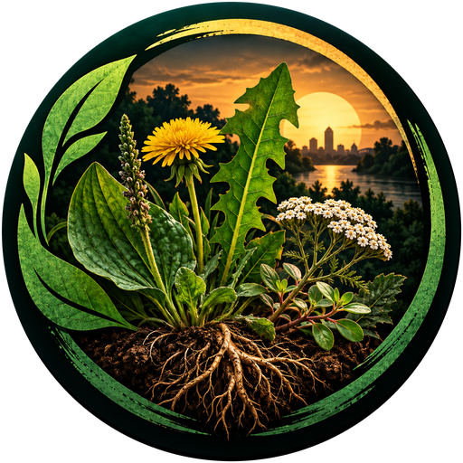

<div align="center">

<a href="https://michaelsboost.com/Urban-Forager/"></a>

# Urban Forager

**A field guide to the plants and fungi around you.**  
Foraging · Field identification · Nutrition · Ethnobotany

[**🌿 Open the app**](https://michaelsboost.com/Urban-Forager/) · [**📱 Build on Android**](#build-on-android-with-termux) · [**Browse the code**](https://github.com/michaelsboost/Urban-Forager) · [**Report an issue**](https://github.com/michaelsboost/Urban-Forager/issues)

[](https://michaelsboost.com/Urban-Forager/)
[](package.json)
[](LICENSE.md)
[](https://github.com/michaelsboost/Urban-Forager/stargazers)
[](https://github.com/michaelsboost/Urban-Forager/issues)

</div>

> [!CAUTION]
> **Educational reference, not an edibility test.** Never identify or consume wild plants or mushrooms—or use them medicinally—based on an app or photograph alone. Dangerous look-alikes exist. [Read the safety guidance ↓](#safety--research-integrity).

## What is Urban Forager?

A free, open-source web app that helps people explore wild and cultivated plants, fungi, food composition, historical uses, and their relationships with people and ecosystems.

| **Discover** | **Learn** | **Take it into the field** |
|:--|:--|:--|
| Browse **174 dossiers** with photo references, names, habitats, and look-alikes. | Explore **nutrition, Indigenous-use histories, herbal research, and practical plant materials** with sources. | Save **Favorites**, choose **Cards / Grid / List**, and **print selected dossier sections** as a cited field reference. |

**New:** [The Forager's Code](https://michaelsboost.com/Urban-Forager/#/category/forager-code) — 12 principles covering identification, access, sustainable harvesting, ecological respect, and reciprocity. Available from the main menu and linked in species dossiers.

**At a glance:** 343 photo references · 111 nutrition profiles · 1,117 nutrient measurements · 82 Indigenous-use/history records · 45 learning resources.

<details>
<summary><strong>✨ More features</strong></summary>

- Responsive layout for portrait and landscape phones, tablets, and desktops; your chosen browsing layout is remembered.
- Search, filters, Favorites, Recently Viewed, and restored scrolling position after returning from a dossier.
- Selectable print sections, compact PDF-friendly layouts, and applicable source citations.
- Resource links for botanical identification, food composition, ethnobotany, herbal evidence, fibers, dyes, and other materials.
- Attributed dossier photography. Photos have been reviewed by the project owner; live image delivery and offline availability are separate technical questions.

</details>

## Get started

**No installation needed:** **[Launch Urban Forager →](https://michaelsboost.com/Urban-Forager/)** in a browser.

**Developers:** clone the repository, install dependencies, and run locally:

```bash
git clone https://github.com/michaelsboost/Urban-Forager.git
cd Urban-Forager
npm install
npm run serve
```

Open **http://localhost:8081/**. The app is a static web/PWA project; use `localhost` or HTTPS for reliable service-worker behavior.

```bash
npm test         # focused UI, navigation and print regressions
npm run build    # compile CSS and synchronize browser JS / kodeWeave
```

### Build on Android with Termux

**No laptop required.** If you edit or maintain Urban Forager on an Android phone, the included [`termux-build.sh`](termux-build.sh) builds the project directly from [Termux](https://termux.dev/). The script installs JavaScript dependencies in **Termux private storage** and copies the finished `dist/` files back into your project folder, avoiding common build issues on Android shared storage.

**First-time setup** in Termux:

```bash
pkg update
pkg install git nodejs-lts rsync coreutils

git clone https://github.com/michaelsboost/Urban-Forager.git
cd Urban-Forager
bash termux-build.sh
```

**Already have the repository on your phone?** From its folder, simply run:

```bash
bash termux-build.sh
```

If you extracted a ZIP to your phone's **Downloads** folder, first grant Termux storage access using `termux-setup-storage`, then navigate to the extracted directory (for example, `cd ~/storage/downloads/Urban-Forager`) and run the same script. Keeping your Git checkout under Termux's `$HOME` is generally simpler.

**Preview the site locally on your phone** (optional):

```bash
pkg install python
python -m http.server 8081
```

Open `http://127.0.0.1:8081/` in the phone's browser while the server is running. Stop the server with **Ctrl+C** in Termux. The build script requires internet access the first time it downloads dependencies; later rebuilds reuse the private build cache unless the dependency manifest changes. **Building does not publish the site or push changes to GitHub.**

<details>
<summary><strong>📱 What the Android build script does</strong></summary>

1. Checks that it is running inside Termux and that `node`, `npm`, `rsync`, and `sha256sum` are available.
2. Copies the project into a uniquely named build workspace under Termux private storage, excluding Git history and `node_modules`.
3. Installs or reuses dependencies there, then runs `npm run build`.
4. Copies generated `dist/` JavaScript and CSS files back to the original project directory.

If anything fails, read the terminal error and check that you're in the same folder as `package.json` and `termux-build.sh`.

</details>

<details>
<summary><strong>🧑‍💻 Developer notes and repository layout</strong></summary>

```text
Urban-Forager/
├── index.html                   # deployable application
├── src/                         # editable HTML, CSS and JavaScript
├── dist/                        # browser-ready JS and CSS
├── imgs/                        # project branding and icons
├── libraries/                   # packaged browser libraries
├── termux-build.sh              # Android / Termux build helper
├── tests/                       # focused regression tests
├── tools/sync-js.cjs            # JS / kodeWeave sync
├── manifest.json, sw.js         # PWA assets and app-shell cache
├── urbanforager-kodeWeave.json  # portable editor project
└── package.json
```

Edit `src/script.js` for application logic and run `npm run build:js` to synchronize `dist/script.js` and the kodeWeave copy. `src/source.html` is editable markup; maintain consistency with `index.html` when changing the UI. `npm run build:css` compiles the stylesheet. The optional legacy optimized Rollup pathway requires separate verification before publishing.

The repository ZIP is intended to be extracted **into** an existing Git checkout: preserve the checkout's `.git` directory, inspect `git diff`, test, commit, and push. Distribution ZIPs do not include Git history.

</details>

## Explore further

The in-app **Resources** section organizes additional study material. Start with:

| Topic | Reference |
|:--|:--|
| **Nutrition and food composition** | [USDA FoodData Central](https://fdc.nal.usda.gov/) |
| **Plant names and distribution** | [Kew Plants of the World Online](https://powo.science.kew.org/) · [USDA PLANTS](https://plants.sc.egov.usda.gov/home/) |
| **Herbal evidence and interactions** | [NIH NCCIH](https://www.nccih.nih.gov/health/herbsataglance) |
| **Indigenous knowledge and ethnobotany** | [Smithsonian Native Knowledge 360°](https://americanindian.si.edu/nk360/) |
| **Plant fibers, dyes and crafts** | [USDA Forest Service Ethnobotany](https://www.fs.usda.gov/wildflowers/ethnobotany/) |

<details>
<summary><strong>🧺 About Indigenous uses, sources, and the dataset</strong></summary>

Urban Forager has **174 dossiers**, but not every research area has complete, well-supported evidence. **82 dossiers** currently contain substantive documented Indigenous-use or ancestral-crop-history entries; **92 remain for further research**. These are not claims that a species lacked cultural use. Sources should name communities or nations when the evidence supports that attribution, and avoid presenting modern cultivars as ancient varieties.

The app currently references **343 attributed images**. Those pictures cannot establish the identity or edibility of a wild specimen. Many still require network access because the image files are hosted externally rather than bundled for fully offline use.

Nutrition data currently spans **111 profiles** and **1,117 measurements**. Values depend on growing conditions, cultivar and preparation; “not reported” must not be confused with zero. Historical medicinal use must not be confused with demonstrated clinical efficacy.

When printing, you can choose **All** sections or customize: Identification, Safety, Food & Harvesting, Nutrition, Medicinal Uses, Indigenous Uses, Modern Research, Practical Utility, Stewardship, History, and Sources. Use the browser print dialog to save a PDF where supported.

</details>

## Printable reference grids

The in-app **Print / Save as PDF** dialog now defaults to a **two-column × four-row field grid** (8 summary cards per US Letter sheet), matching the supplied complete and field examples. It can print the full 174-dossier library (22 pages), the first 95 field dossiers (12 pages), search results, favorites or hand-picked records. The grid summarizes edible parts, six source-reported nutrient quantities where available, medicinal/traditional-use context, Indigenous history, and safety cautions. The full Compact and Detailed dossier modes still retain complete citations and configurable research sections.

For convenience, ready-to-print reference snapshots are included under [`printables/`](printables/). These examples are static; printing from the app reflects the current dossier data. For best results print US Letter / portrait / 100% and turn off browser header/footer overlays.

## Safety & research integrity

- **Field identification:** Confirm multiple diagnostic features, habitat, range, season and dangerous look-alikes with independent expert-quality sources. Some mushrooms and plants can be lethal.
- **Food and harvesting:** Verify the exact species, plant part, preparation, environmental contamination, and local rules before use.
- **Medicine:** Traditional and documented uses are educational history, not medical advice or proof of efficacy. Check toxicity, contraindications and drug interactions.
- **Indigenous knowledge:** Prefer community-specific attribution, respect living knowledge holders, and make research gaps visible instead of inventing claims.
- **Stewardship:** Follow laws and permissions; protect habitats, regeneration, wildlife and future harvests.

> [!IMPORTANT]
> In case of a suspected poisoning or serious exposure, contact emergency services or poison control. Do not use this app to determine treatment.

## Contribute

Found a broken source, unclear plant description, missing reference, accessibility problem, or opportunity to improve offline use? **[Open a GitHub issue](https://github.com/michaelsboost/Urban-Forager/issues)** with the relevant dossier and evidence.

<div align="center">

Created by **Michael Schwartz** · [Website](https://michaelsboost.com/) · [Support the project](https://michaelsboost.com/donate/)

[MIT License](LICENSE.md) for project code. Third-party photographs and other materials retain their own applicable licenses and attribution requirements.

*The database is the tool. Reconnection is the purpose.*

</div>

### The Forager's Code on the homepage

The homepage prominently shows the **12 Rules of Foraging** as a readable checklist
under the hero, with links to the complete Forager's Code page. The detailed
page remains available from the main menu and individual species dossiers.


### Responsive homepage and learning videos

Home hero actions span the full available width on phones. Both mobile and
desktop show a large, clickable featured-video preview. On desktop, the preview
uses a split layout (video description beside a prominent 16:9 poster) above
the horizontal, scrollable video gallery; the existing full-image mobile poster
is unchanged. Both the featured video and thumbnails open the local lightbox
in one click. The lightbox supports switching videos and destroys the iframe
on close so playback stops. The print grids, 12 rules, and full dossiers are
unchanged.
