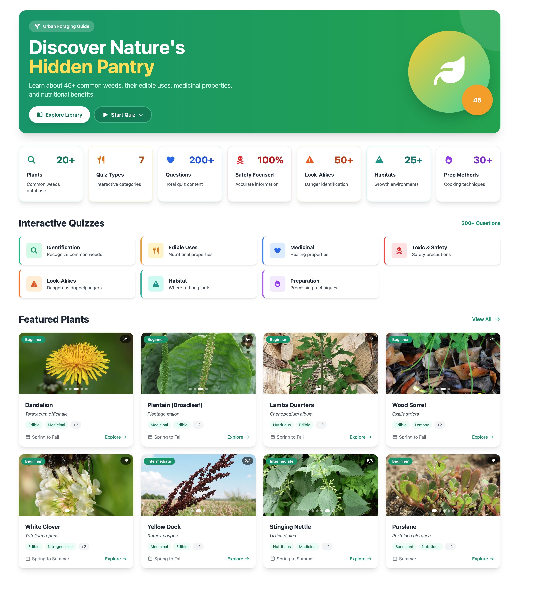

# **Urban Forager**

_Learn the wild plants growing around you._



[](LICENSE) [](https://github.com/michaelsboost/Urban-Forager/stargazers) [](https://github.com/michaelsboost/Urban-Forager/issues)

----------

## **🚀 About Urban Forager**

Urban Forager is an **educational, offline-friendly foraging app** designed to help people learn about the edible, medicinal, and nutritional uses of common wild plants — especially the “weeds” most people overlook.

Built entirely with **[kodeWeave](https://michaelsboost.github.io/kodeWeave)**, the app features:

- A **full plant library** with multiple verified images per plant  
- Detailed **edibility, medicinal, and safety information**  
- Clear **identification features** & warning notes for toxic lookalikes  
- A **quiz mode** to help users learn through play  
- Runs 100% client-side — no server required  

The goal: **free survival knowledge for everyone**.

----------

## **🌟 Features**

✅ **Full Plant Library** – Explore detailed profiles of wild edible & medicinal plants  
✅ **High-Quality Plant Images** – Multiple verified photos per plant  
✅ **Identification Guidance** – Leaf shapes, flowers, stems, growth patterns & more  
✅ **Look-Alike Warnings** – Toxic vs edible distinctions made clear  
✅ **Edible Parts & Uses** – Culinary, nutritional, and historical medicinal info  
✅ **Safety First** – Strong caution notes where risk exists  
✅ **Interactive Quiz Mode** – Learn through fun questions  
✅ **Offline-Friendly** – Works in your browser, no internet required  
✅ **Lightweight & Fast** – No bloat, no tracking, no nonsense  

----------

## **🎮 Learn By Playing**

Urban Forager includes a built-in **quiz system** to help users actually *learn*, not just read.

Quiz categories include:

- 🕵️ Identification  
- 🥗 Edible Uses  
- 🌿 Medicinal Uses  
- ☠️ Toxic Plants  
- 👯 Look-Alikes  
- 🌍 Habitat  
- 🍳 Preparation & Processing  

Each question includes:
- Multiple-choice answers  
- A correct answer  
- A short explanation that *actually teaches something*  

----------

## **🌿 Plant Data Structure**

Plant data lives in the `weeds` array.  

Each plant is stored as an object like this:

```js
{
  id: 37,
  commonName: "Queen Anne's Lace (Wild Carrot)",
  emoji: "🤍",
  images: [...],
  scientificName: "Daucus carota",
  family: "Apiaceae",
  description: "A wild ancestor of cultivated carrot...",
  season: "Summer",
  habitat: "Fields, roadsides, disturbed ground",
  difficulty: "Advanced",

  tags: ["Edible (Caution)", "Medicinal", "Carrot Family"],

  identifyingFeatures: [...],
  lookAlikes: "...",
  edibleParts: [...],
  harvestingNotes: "...",
  culinaryUses: [...],
  recipes: [...],
  medicinalUses: [...],
  preparationMethods: [...],
  safetyNotes: "...",

  nutritionalSummary: "",
  nutrients: [...],
  healthBenefits: [...]
}
```

----------

## **🧠 Quiz Data Structure**

Quiz questions are stored in categorized arrays:

```js
questions: {
  identification: [
    {
      text: "Which weed has yellow flowers that become white puffballs?",
      options: ["Plantain", "Dandelion", "Chickweed", "Curly Dock"],
      correctAnswer: "Dandelion",
      explanation: "Dandelion forms iconic white puffball seed heads.",
    }
  ],
  edible: [...],
  medicinal: [...],
  toxic: [...],
  lookalikes: [...],
  habitat: [...],
  preparation: [...]
}
```

----------

## **📥 Installation & Setup**

Urban Forager is **fully web-based**.  
No installation. No server. Just open and use.

### **Run Online**
Link coming soon once published 🙂

### **Run Locally**

Clone the repo:

```
git clone https://github.com/michaelsboost/UrbanForager.git
cd UrbanForager
```

Run a simple local server (example using Python):

```
python3 -m http.server 8000
```

Then open:
```
http://localhost:8000
```

That’s it.

----------

## **🤝 Contributing**

Contributions are **welcome and appreciated** ❤️

You can help by:
- 📸 Adding accurate plant images  
- 🌿 Submitting new plant data  
- 🧠 Writing quiz questions  
- 🐞 Fixing mistakes or improving accuracy  

----------

## **⚠️ Disclaimer**

This app is for **educational purposes only**.

- Never consume a plant unless you are **100% certain** of identification  
- Many plants have **dangerous or deadly look-alikes**  
- Some plants are only edible in certain **seasons or stages**  
- People may experience **allergic reactions**  
- Always verify using multiple trusted sources  

**You are responsible for your own safety.**

----------

## **🧪 Tech Stack**

Urban Forager is built to be lightweight, fast, and easy to contribute to:

* **⚡ AlpineJS** – simple reactive UI without large frameworks
* **🎨 Tailwind CSS** – clean styling with utility classes
* **⭐ Font Awesome** – icons used throughout the interface
* **🌐 100% Client-Side**
* **📦 No build tools, no backend, no dependencies**

Runs anywhere a browser runs.

----------

## **📜 License**

Urban Forager is **open-source** under the **MIT License**.  
See the full license: `LICENSE`

----------

## **💡 Want to Contribute?**

Awesome! Urban Forager is **free and open-source**, and contributions are always welcome.

### **How You Can Help:**

🔹 **Submit a Pull Request** – Found a bug? Have a feature idea? Let's build together!  
🔹 **Spread the Word** – Share Urban Forager with fellow developers, creators and nature lovers.  
🔹 **Fork & Experiment** – Urban Forager is yours to play with—have fun with it!

If Urban Forager has been helpful to you, here are some ways you can show support:

[](https://ko-fi.com/michaelsboost)

☕ **Buy me a coffee:** [ko-fi.com/michaelsboost](http://ko-fi.com/michaelsboost)  
🎨 **Grab some of my art prints:** [DeviantArt Store](https://deviantart.com/michaelsboost/prints)  
👕 **Get a kodeWeave T-shirt or gear:** [Merch Store](https://michaelsboost.com/gear)  
📚 **Check out my Graphic Design Course:** [Learn Design](https://michaelsboost.com/graphicdesign)  
🛒 **Register as a customer on my store:** [Visit Store](https://michaelsboost.com/store)  
💙 **Donate via PayPal:** [Support via PayPal](https://michaelsboost.com/donate)  
💸 **Donate via Cash App:** [Support via SquareCash](https://cash.me/$michaelsboost)

Your support helps keep Urban Forager free, open-source, and constantly improving. 🚀

----------

## **📧 Contact**

Created by: **Michael Schwartz** - https://michaelsboost.com
Maintained by: **The Open Source Community**  
