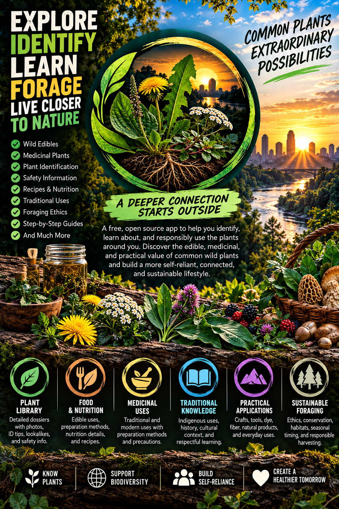

# URBAN FORAGER

**The database is the tool. Reconnection is the purpose.**

Urban Forager is a free, open-source educational field reference for learning the wild plants, trees, shrubs, vines, and fungi around you, understanding how people have interacted with them, and rebuilding a more informed relationship with the living world.



[](https://michaelsboost.com/Urban-Forager/)
[](https://github.com/michaelsboost/Urban-Forager)
[](LICENSE.md)
[](https://github.com/michaelsboost/Urban-Forager/stargazers)
[](https://github.com/michaelsboost/Urban-Forager/issues)

---

## 🌿 About Urban Forager

Urban Forager is designed to make plant and fungal knowledge useful in the field without reducing foraging to a list of things people can take.

The app brings together identification, dangerous look-alikes, edibility, harvesting and preparation, nutrition, medicinal information, documented Indigenous uses, modern research, history, practical utility, stewardship, legal and access context, educational media, and outside learning resources.

The larger purpose is reconnection: learning what grows around us, recognizing that wild places are communities rather than inventories, and approaching harvesting with responsibility, reciprocity, permission, and respect for regeneration and wildlife.

No account is required. Urban Forager is free, open source, client-side, mobile-first, and designed for desktop and mobile use as both a browser application and installable Progressive Web App.

---

## 🚨 What’s New in 1.0.0

Version **1.0.0** is the first official release of the redesigned Urban Forager and expands the project into a larger evidence-structured field reference.

- The field library now contains **95 dossiers** covering wild plants, trees, shrubs, vines, edible fungi, invasive species, and important toxic or deadly look-alikes.
- The original 45 records were normalized to the same master dossier structure used by the newer expansion records.
- Dossiers prioritize identification and safety before food, nutrition, medicine, traditional knowledge, history, utility, stewardship, and other uses.
- The Plants & Fungi library uses real species imagery rather than emoji placeholders, with scientific-name image fallback behavior when a primary image fails.
- Search can focus on **Plants, Nutrition, Medicine, Food, Indigenous Uses, History, Safety, or Everything**.
- Stackable filters make it possible to narrow the library by nutrients, edible parts, season, habitat, and related traits.
- Nutrition claims were re-audited so quantitative values require an appropriate direct food-composition source, while unsupported qualitative rankings and proxy values are removed rather than guessed.
- Indigenous-use entries were reviewed for attribution and documentation status so specific nations or communities are named when the evidence supports that specificity.
- Fungi dossiers include organism-specific identification details such as gills, pores, ridges, teeth, substrate, host association, internal structure, and dangerous mushroom look-alikes where relevant.
- The Resources Library includes curated videos, courses, books, ethnobotany references, identification tools, nutrition and medicine references, maps, educators, and other learning material.
- The homepage includes a horizontally scrollable educational media experience with in-app playback where supported.
- Saved Dossiers and Recently Viewed provide local browser persistence without requiring an account.
- Stewardship guidance connects foraging with sustainable harvest, legal access, habitat protection, regeneration, wildlife, waste reduction, and reciprocity.
- Direct URL navigation and browser history allow major views and individual dossiers to be bookmarked, shared, opened directly, and navigated with browser or Android Back/Forward controls.
- Progressive Web App metadata and an offline application shell are included.
- A self-contained **kodeWeave project** is included for portable CodePen-style testing and sharing.
- Project metadata and release files are synchronized for version **1.0.0**.

---

## 🏡 The Homepage

The homepage is intentionally more than a conventional product landing page. It introduces the reason Urban Forager exists before sending visitors into the database.

The central idea is simple:

> **The database is the tool. Reconnection is the purpose.**

The homepage connects identification and field knowledge with stewardship, reciprocity, safety, educational media, and practical paths into the larger library.

Visitors can begin learning before opening a single dossier, then move into identification, research, outside resources, and practical field knowledge as deeply as they want.

---

## 🔎 Plants & Fungi Library

Plants & Fungi is the main field-reference library.

Visitors can search across the collection or focus the search on a particular kind of information:

- Plants
- Nutrition
- Medicine
- Food
- Indigenous Uses
- History
- Safety
- Everything

Filters can be combined rather than operating as mutually exclusive categories. This makes searches such as season plus habitat plus edible part possible without abandoning the broader search.

Search terminology also normalizes supported aliases so related terms can be easier to find.

Species cards use actual organism imagery to help visitors visually recognize plants and fungi they may already have encountered. Images are an educational aid, not a substitute for complete identification.

---

## 🌱 Dossiers

Each dossier is organized around a safety-first information hierarchy.

A dossier can include:

- common and scientific names
- family or taxonomic context
- identification features
- habitat and season
- dangerous look-alikes
- safety and caution information
- edible parts
- harvesting and preparation guidance
- culinary uses
- nutrition information
- medicinal uses and preparation
- documented Indigenous uses
- modern uses and research
- history
- practical utility
- stewardship, conservation, and legal/access context
- sources and evidence notes

Not every organism has reliable information for every field. Urban Forager does not invent content simply to fill a section.

A reviewed dossier means its current claims were checked against the sources associated with that record, unsupported legacy statements were removed or qualified, and missing evidence is left visible rather than guessed. It does **not** mean every publication that could possibly exist has been exhausted.

---

## ⚠️ Identification & Safety

Correct identification comes before use.

Wild plants and fungi can vary with age, season, growing conditions, damage, substrate, geography, and developmental stage. Some edible species have toxic or deadly look-alikes, and photographs alone are not sufficient for every identification.

Urban Forager should be treated as one part of a verification process rather than a guarantee that an unknown specimen is safe to consume or use medicinally.

Never eat or medicinally use a wild plant or fungus unless you can positively identify it and have checked appropriate current safety information from reliable sources.

---

## 🥗 Food & Nutrition

Food information can include edible parts, harvest timing, preparation, culinary uses, and relevant cautions.

Nutrition information distinguishes general descriptions from quantified composition data. A qualitative statement such as “source of vitamin C” is not treated as interchangeable with a measured nutrient value.

The nutrition inventory has been audited so numeric values are used only when an appropriate source matches the organism or supported food record, edible part, and preparation closely enough to justify the claim. USDA FoodData Central is preferred when an appropriate record exists, with peer-reviewed composition research used where suitable.

If a nutrient was not measured or a sufficiently direct source was not found, Urban Forager treats it as **not reported**, not as zero. Values can also vary with soil, geography, season, maturity, storage, and preparation.

This information is educational and is not individualized nutritional or medical advice.

---

## 🌿 Medicine

Medicinal information is separated conceptually into historical or traditional use and modern evidence.

An organism having a history of medicinal use does not establish that it is clinically effective for a condition, safe at every dose, safe during pregnancy, or compatible with medications.

Modern medical and botanical-safety claims should use appropriate evidence such as NCCIH, NIH, toxicology resources, peer-reviewed research, extension resources, poison-control resources, or other qualified sources depending on the claim.

Urban Forager aims to preserve useful ethnobotanical context without presenting traditional use as proof of modern clinical efficacy.

---

## 🪶 Indigenous Uses & Ethnobotany

Urban Forager avoids flattening many distinct peoples into generic statements such as “Native Americans used this plant.”

When a traditional use is documented, the preferred approach is to identify the specific nation, community, or documented cultural context and provide the source supporting that attribution.

All dossiers include either reviewed Indigenous-use information or an explicit documentation-status entry. When a sufficiently specific record was not located in the reviewed sources, the dossier says so rather than turning absence of documentation into a claim of non-use.

Daniel E. Moerman’s *Native American Ethnobotany* is an important research starting point, but individual claims should still be evaluated in context and stronger or more direct documentation should be used when available.

Indigenous knowledge is not merely a collection of survival tricks or raw material for extraction. Context, attribution, living communities, and responsible use matter.

---

## 🧰 Practical Utility

Wild plants can have practical roles beyond food and medicine.

Where documentation supports it, dossiers may include uses such as:

- fiber and cordage
- dyes
- tinder
- containers
- tools
- construction materials
- soaps or cleaning uses
- repellents
- adhesives
- other documented material uses

A practical use is included because evidence supports it, not because every dossier needs a utility section.

---

## 🌎 Stewardship & Reciprocity

Foraging is not only about what can be harvested.

Urban Forager encourages visitors to consider:

- whether harvesting is legal and permitted
- the health and size of the local population
- habitat disturbance
- wildlife that depends on the same organisms
- leaving enough for flowering, fruiting, sporulation, seed production, and regeneration
- avoiding unnecessary waste
- native, introduced, invasive, threatened, and conservation context
- taking only what can actually be used
- giving back through restoration, cleanup, propagation, habitat care, and other forms of reciprocity

The project treats ecological responsibility as part of field knowledge rather than an optional extra.

---

## 🎬 Watch & Learn

The homepage includes an educational media experience for visitors who learn well by watching experienced educators and foragers work with plants and fungi in the field.

The collection can include material from educators, botanists, ethnobotany researchers, mushroom educators, and other specialists whose work helps extend the built-in dossiers.

Videos with supported embeds can play inside Urban Forager. When a provider restricts embedding or requires viewing on its own platform, the app can direct the visitor to the original source instead of presenting a broken player.

External media remain the responsibility of their respective publishers and may change availability, URLs, access requirements, or content over time.

---

## 📚 Resources Library

The Resources Library extends Urban Forager beyond its built-in dossiers.

Categories include:

- Watch
- Courses
- Books
- Ethnobotany
- Identification
- Nutrition
- Medicine
- Maps & Tools
- Reference
- Creators

Resources can include government databases, university collections, educational videos, field educators, books, courses, mapping tools, identification references, nutrition databases, ethnobotany collections, and specialist resources.

A visual card is used when reliable artwork or a real thumbnail is available. Resources without trustworthy imagery use an intentional text-first presentation rather than misleading placeholder artwork.

External resources remain the responsibility of their respective publishers and can change URLs, availability, access requirements, or content over time.

---

## ✨ Features

- 95-dossier wild plant, tree, shrub, vine, and fungi library
- Safety-first organism dossiers
- Real species imagery in the Plants & Fungi library
- Species-image fallback behavior when a primary image fails
- Identification and dangerous-look-alike guidance
- Edibility, harvesting, preparation, and culinary information
- Audited nutrition information with source-specific quantitative values where supported
- Traditional-use and modern medicinal context
- Documented Indigenous-use and ethnobotany fields
- Explicit documentation status when specific evidence is not located
- History and modern-use information
- Verified practical utility where available
- Stewardship, conservation, reciprocity, and legal/access context
- Search by information intent
- Stackable field-library filters
- Nutrient-term normalization
- Saved Dossiers
- Recently Viewed
- Curated Resources Library
- Homepage educational video experience
- In-app video lightbox where supported
- Direct shareable URLs for dossiers and major views
- Android/browser Back and Forward navigation
- Direct-link restoration
- Responsive desktop and mobile layouts
- Local browser persistence
- Progressive Web App support
- Offline application shell
- No account required
- No backend required
- Open-source MIT-licensed code
- Included kodeWeave project for portable testing and sharing

---

## 🧩 Information Model

Urban Forager connects organism identity, safety, human use, evidence, and stewardship instead of treating each subject as an isolated article.

```text
Organism
  ├── Identification
  ├── Look-alikes & safety
  ├── Food
  │   ├── Edible parts
  │   ├── Harvesting
  │   └── Preparation
  ├── Nutrition
  ├── Medicine
  │   ├── Historical / traditional use
  │   └── Modern evidence
  ├── Indigenous uses
  │   ├── Nation / community
  │   ├── Documented use
  │   └── Documentation status
  ├── Modern uses & research
  ├── History
  ├── Practical utility
  ├── Stewardship / legal context
  └── Sources

Learning
  ├── Videos
  ├── Courses
  ├── Books
  ├── Ethnobotany
  ├── Identification
  ├── Nutrition
  ├── Medicine
  ├── Maps & tools
  ├── Reference
  └── Creators
```

This structure helps a visitor move from “What is this?” to “How do I identify it safely?”, “How have people interacted with it?”, “What does the evidence support?”, and “How do I interact with it responsibly?”

---

## 📖 Sourcing & Accuracy

Urban Forager aims to distinguish documented facts, historical uses, traditional knowledge, modern evidence, general guidance, and uncertainty.

Preferred evidence includes:

- USDA FoodData Central for appropriate quantitative food-composition data
- USDA PLANTS and other botanical or mycological authorities for taxonomy and distribution
- government, university, extension, herbarium, and natural-history resources for identification and ecology
- NCCIH, NIH, toxicology resources, poison-control resources, and peer-reviewed research for medicinal and safety claims
- direct ethnobotanical documentation and appropriately attributed historical sources for Indigenous uses
- Daniel E. Moerman’s *Native American Ethnobotany* as one important ethnobotanical research starting point

The project favors visible limitations over false certainty. “Not reported” does not mean zero, lack of a documented Indigenous-use record does not prove non-use, historical medicinal use does not establish clinical efficacy, and a photograph does not establish a safe identification by itself.

Claims should be corrected when stronger evidence becomes available. Corrections, stronger primary sources, better attribution, and more precise evidence are welcome.

---

## 🔗 Direct URLs & Browser Navigation

Major screens use hash-based routes and dossiers use stable numeric IDs so views can be copied, bookmarked, and shared.

Examples:

```text
#/category/home
#/category/library
#/category/resources
#/category/favorites
#/category/recent
#/category/about
#/dossier/8
```

Opening a dossier pushes its route into browser history. A `hashchange` listener restores the matching screen or dossier when the visitor uses browser or Android Back/Forward navigation.

When a shared dossier URL is opened directly, Urban Forager creates the library route beneath that dossier in browser history so a Back gesture returns to the Urban Forager library instead of immediately leaving the application.

Stable numeric IDs are used for dossier URLs so correcting or reformatting a common name does not automatically break existing shared links.

---

## 🛠️ Technology

Urban Forager is a browser-based static application built with:

- HTML5
- JavaScript
- Alpine.js
- Tailwind CSS
- custom CSS
- PostCSS / Autoprefixer / cssnano
- Rollup / Terser
- Progressive Web App APIs
- History API / hash routing

The application does not require an account or application backend.

### 📁 Project Structure

Key release files include:

- `src/source.html` — application markup used by the standalone and kodeWeave builds
- `src/bundle.css` — primary CSS build entry
- `src/style.css` — additional application styling
- `src/script.js` — Alpine application behavior, dossier data, resources, search, media, image handling, and routing
- `dist/bundle.css` — compiled production CSS
- `dist/script.js` — compiled production JavaScript
- `index.html` — deployable application page
- `manifest.json` — Progressive Web App metadata
- `sw.js` — service worker and offline application shell
- `urbanforager-kodeWeave.json` — self-contained kodeWeave project
- `termux-build.sh` — Termux build helper

### Architecture Notes

`src/source.html` intentionally contains body-level application markup rather than a complete standalone HTML document.

The Alpine root uses:

```html
<div x-data="urbanForager()" x-init="init()">
```

The JavaScript must continue exposing the Alpine component globally:

```js
window.urbanForager = urbanForager;
```

The production JavaScript is bundled as an IIFE. Removing that global export can prevent Alpine from resolving `urbanForager()` and leave the application hidden behind `x-cloak`.

The source, production build, and kodeWeave project should remain synchronized when application behavior or dossier data changes.

---

## 🧪 kodeWeave Project

The repository includes `urbanforager-kodeWeave.json` for opening, testing, and sharing Urban Forager in kodeWeave.

The project follows kodeWeave’s CodePen-style editor model: application HTML is stored in the HTML editor, CSS in the CSS editor, and JavaScript in the JavaScript editor. The HTML field contains the app’s body-level content rather than a full document wrapper.

The kodeWeave file is intended as a portable testing and sharing version of the same application, not a separate product.

---

## 💻 Run Locally

Clone the repository:

```bash
git clone https://github.com/michaelsboost/Urban-Forager.git
cd Urban-Forager
```

Install development dependencies:

```bash
npm install
```

Build production CSS and JavaScript:

```bash
npm run build
```

Start the included local server:

```bash
npm run serve
```

The configured development server runs on port `8081`.

For Termux, the repository also includes:

```bash
./termux-build.sh
```

Because Urban Forager is a static client-side application, it can also be served by another static web server or deployed to static hosting.

---

## 🌐 Live App

**Urban Forager:** https://michaelsboost.com/Urban-Forager/

**Source:** https://github.com/michaelsboost/Urban-Forager

---

## 🌱 Companion Project: Zerra

Urban Forager focuses specifically on field identification, wild-food and fungal knowledge, ethnobotany, safety, evidence, practical use, and responsible interaction with the living world.

**Zerra** is a separate companion project exploring the wider relationship between human activity and Mother Earth through ecological literacy, responsibility, practical skills, reciprocity, waste reduction, and regeneration.

Zerra: https://michaelsboost.github.io/Zerra

Source: https://github.com/michaelsboost/Zerra

---

## ⚕️ Disclaimer

Urban Forager is an educational resource, not medical, nutritional, legal, toxicological, or emergency advice.

Never consume or medicinally use a wild plant or fungus unless you are certain of its identity and have checked appropriate current safety information. Some organisms have dangerous or deadly look-alikes. Individual reactions, allergies, medication interactions, preparation requirements, contamination, environmental conditions, and local harvesting laws can also matter.

Photographs can support learning and recognition but cannot by themselves establish that an unknown specimen is safe to eat or use.

Information can become outdated as taxonomy, research, regulations, external resources, and scientific understanding change.

For poisoning, suspected dangerous exposure, or another urgent medical situation, contact the appropriate emergency or poison-control service rather than relying on the app.

---

## 🤝 Contributing

Contributions that improve accuracy, sourcing, accessibility, usability, or educational value are welcome.

Useful contributions include stronger primary or peer-reviewed sources, taxonomic corrections, improved identification details, dangerous-look-alike guidance, better food and nutrition documentation, toxicity research, responsibly attributed ethnobotanical records, verified practical uses, species-image corrections, accessibility fixes, responsive-layout improvements, translations, and updated resource links.

Please do not submit invented citations, unsupported plant or fungal uses, generic cultural attributions, copied proprietary material, misleading identification images, or factual claims presented with more certainty than the evidence supports.

When editing the application, preserve synchronization between the source, production build, and kodeWeave versions.

---

## ❤️ Support

Urban Forager is an independent open-source project. If you want to support it, you can star or share the repository, contribute corrections or code, improve its sources, or support continued development.

Donate: https://michaelsboost.com/donate/

---

## 📄 License

Urban Forager is open-source software licensed under the MIT License.

See [LICENSE.md](LICENSE.md).

---

## 📬 Contact

Michael Schwartz  
https://michaelsboost.com
